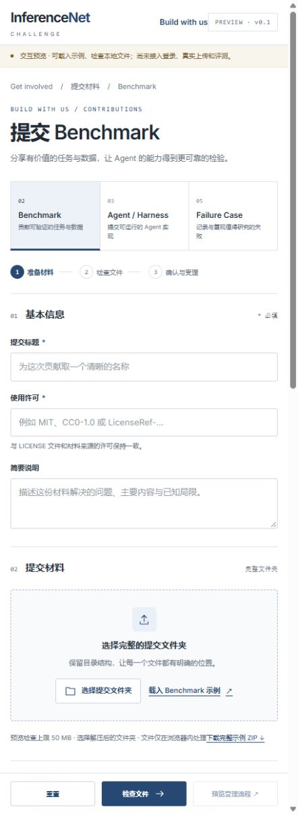

# Build with us 提交系统 Handoff

日期：2026-10-21（Asia/Shanghai）。目标仓库：`EasonAI-5589/inferencenet-challenge`。

**HF 存储与合成模板已就绪；三个提交页面目前是独立的本地交互预览，正式登录、上传、受理回执和评测队列尚未实现。** 本次 PR 交接文档和预览截图，不把预览程序部署到官网，也不迁入第三方提交、私有日志或评测材料。

接手时先阅读本页，再按需要阅读 [提交格式 v0.1.0](../submissions/SPEC.md) 和 [页面与 API 设计](../submissions/API-DESIGN.md)。这两份仓内文档已将历史部署状态与回执字段对齐到本页；HF 内的 `specs/v0.1.0/SPEC.md` 保留原始快照，其“尚未创建仓库”措辞是历史状态。

## 已确定的产品范围

| Get involved 卡片 | 提交服务路由 | 协议 type | HF Dataset 仓库 |
|---|---|---|---|
| ② Submit a benchmark | `/submit/benchmark/` | `benchmark` | `InferenceNet/benchmark-submissions` |
| ③ Submit an agent / harness | `/submit/harness/` | `harness` | `InferenceNet/harness-submissions` |
| ⑤ Submit a failure case | `/submit/failure-case/` | `failure_case` | `InferenceNet/failure-case-submissions` |

- 三个页面共享表单、登录、上传、预检、受理和状态查询组件；页面路由固定类型，服务端固定仓库映射。
- Explorer / Explore 只保留浏览入口，不增加上传窗口。其他合作卡片不并入这三类提交协议。
- `InferenceNet/evaluation-results` 由受理及结果服务写入，没有第四个用户提交入口。
- GitHub 保存规范、模板和实现代码；提交内容及 benchmark 材料保存到 HF。私有回执、原始日志、未发布任务、参考答案不进入公开 Issue、PR、Pages 或此仓库。
- 灰度期四仓均为 private。后续公开发布经过审核的独立版本，不能直接将整个提交仓转为公开。

## 当前交付状态

| 部分 | 当前事实 | 接手时不要假设 |
|---|---|---|
| HF 初始化 | 四个私有 Dataset 仓已创建；53 个文件上传后按固定 commit 下载并核对 bytes/SHA256 | 仓库存在不代表受理 API 或评测已上线 |
| 格式与示例 | 三类文件包、静态校验器、合成样例已准备；各 HF 提交仓可取得本类样例 | 示例 runtime 声明不是已冻结、可执行的生产环境 |
| 本地页面 | 三条独立路由可切换、载入示例、检查文件和预览受理流程 | 本地地址不是外部用户可访问的提交地址 |
| 官网 | 此 PR 只加入交接资料和 README 链接 | 第 ②、③、⑤ 张卡片尚未接入真实提交服务 |
| 登录与受理 | API、身份、状态及幂等规则已写成设计 | OAuth app、会话、数据库、上传暂存与队列尚未实现 |
| 评测 | 运行审核、锁定版本和结果归档规则已确定 | 没有自动执行第三方 Harness，也未完成通用 Benchmark 的 Harbor 集成 |

<a id="hf-storage"></a>
## HF 存储与已核验版本

初始化成功时间为 2026-10-21 19:28（Asia/Shanghai）。下表是当时固定的初始化 commit，不代表未来的 `main`。文件数不计 HF 自动生成的 `.gitattributes`。

| 私有仓库 | 上传并下载核验的文件数 | 初始化 commit |
|---|---:|---|
| [benchmark-submissions](https://huggingface.co/datasets/InferenceNet/benchmark-submissions) | 21 | `1c4fa3c3c4c421f4eb60a8e226c6306e88b9434a` |
| [harness-submissions](https://huggingface.co/datasets/InferenceNet/harness-submissions) | 14 | `d2f0f30591b394e7ab7b3d59c757392da650b36f` |
| [failure-case-submissions](https://huggingface.co/datasets/InferenceNet/failure-case-submissions) | 13 | `462d0c505ebad0443bf5bdc815d75eeae72c9bbb` |
| [evaluation-results](https://huggingface.co/datasets/InferenceNet/evaluation-results) | 5 | `af18a5c0b7d4dbb8cb858a30948540cb48827e68` |

每个提交仓包含 `README.md`、`specs/v0.1.0/SPEC.md`、`tools/validate_submission.py` 及 `examples/<类型>/`。结果仓包含规范、`schemas/README.md` 和 `examples/local-verification/` 中已有的本地验证报告；这里的 schemas 目录是记录要求说明，并非已实现的 JSON Schema 校验器。

**`examples/` 不进入正式提交发现、作业队列或榜单。** 初始化没有创建正式 `submissions/`、受理回执或评测 run。三类示例本身分别含 18、11、10 个文件；与上表的差额是仓库 README、规范和校验工具。

已有 InferenceNet 读取权限的开发者可使用官方 `huggingface_hub` 在本机登录后下载固定快照，例如：

```python
from huggingface_hub import snapshot_download

snapshot_download(
    repo_id="InferenceNet/benchmark-submissions",
    repo_type="dataset",
    revision="1c4fa3c3c4c421f4eb60a8e226c6306e88b9434a",
    local_dir="work/private-bootstrap/benchmark-submissions",
    token=True,
)
```

在仓库外保存下载结果。凭据通过本机登录或部署密钥管理提供，不能写入源码、命令行示例或文档；这份 Handoff 不携带任何可复用令牌。第三方提交者也不取得整个组织仓库的读写凭据。

正式归档目录约定：

```text
<对应提交仓>/submissions/<submission_id>/v<version>/
  submission.json
  README.md
  LICENSE
  benchmark.json | harness.json | case.json
  ...材料...

evaluation-results/
  receipts/<submission_id>/v<version>/receipt.json
  receipts/<submission_id>/v<version>/validation.json
  runs/<run_id>/run-lock.json
  runs/<run_id>/results.json
  runs/<run_id>/artifacts/...
```

版本只追加，已受理包不覆盖。目录名称本身不提供不可变性或权限隔离：可信回执必须同时固定 repo、完整 40 位 commit、包路径和 manifest SHA256，所有权在后端数据库检查；HF 归档还需保留这些 commit 可取回。`job_id` 是队列作业身份，`run_id` 是一次运行的归档身份，两者在数据库映射。

## 三类文件包的主要差异

三类都有 `submission.json`、`README.md`、`LICENSE`，以及类型专属 JSON。manifest 枚举自身以外的全部文件及 bytes/SHA256；固定引用不能使用 `main`、`latest` 或短 SHA。

| 类型 | 核心材料 | 受理后的执行工作 |
|---|---|---|
| Benchmark | `benchmark.json`、划分、来源授权、逐任务说明/环境/输入、oracle 解法、独立评分器 | 划分/来源检查，环境审核，oracle 与错误输出负例验证；审核后才能接纳为正式任务版本 |
| Harness | `harness.json`、实际源码、环境要求/固定依赖、最小输入与预期结果 | 代码与依赖审核，隔离导入与 smoke，再按指定 Benchmark 和协议评测 |
| Failure Case | `case.json`、`reproduce.json`、`reproduce.md`、原始运行锁/观察/事件，以及输出或输出缺失证明 | 分别执行重评分、离线复现或在线重跑，记录预定尝试与判据 |

Harbor 接口暂定项目已锁定的 `harbor-base-agent-v0.24.0`，入口为 `module:Class`。Benchmarks 采用 Harbor task schema 1.4。现有 Dev100 驱动对固定任务集有假设，不能因为新包通过 schema 校验就直接交给它运行；应对新 Benchmark 做独立适配和协议审核。

Failure Case 的 `score_only`、`offline_replay` 和 `live_agent_rerun` 必须区分。结果只能在实际执行并核对判据后标记 reproduced；缺材料、运行基础设施故障或 verifier 异常不能冒充模型有效零分。未知参数或不可用分数保留 null 和原因。

## 页面预览与现有限制

预览采用官网的白底、细分隔线和深蓝色风格。可以在三类间切换，查看材料要求与目录树、下载合成示例 ZIP、载入完整示例、选择本地文件夹并执行浏览器预检。下图是已经检查过的侧边窄窗口，不代表完成官网桌面验收。



浏览器预检仅覆盖部分结构、类型、文件清单、bytes/SHA256；上限为 50 MB，不能替代后端严格 JSON、完整路径、跨引用、split/provenance 校验。页面的类型字段是交互原型，修改字段不会改写文件；生产版本必须决定哪些信息从文件导入，哪些由表单生成，避免双份配置不一致。

示例中的 `local_fixture` 关联只允许演示；正式受理必须拒绝并要求固定 HF 引用。`submission.json` 在预览中由本地包提供，生产 API 设计改为服务端根据已认证身份和核验后的清单生成。

此 PR 不包含预览源代码。源码当前保留在下节的本机交接目录中；若需要保持该版本页面的像素和交互，接手前应取得并迁移这些文件，不能仅凭本网站仓声称可构建该预览。迁移时还需解决：

- `build_preview.py` 引用原机器的官网路径和相邻规范工具包；应改为参数或仓内相对定位。
- `dist/assets/app.js`、`dist/assets/app.css` 是现有源码，不要因位于 dist 就遗漏。
- 页面使用 `/assets/`、`/submit/`、`/docs/` 等根路径，适用于独立提交服务。直接复制到 GitHub Pages 的 `/inferencenet-challenge/` 子路径会失效，必须明确 base path 或部署独立 origin。
- 原预览只有中文；正式网站接入需沿用现有中英文与主题规范，桌面验收遵循仓库 README。

<a id="local-artifacts"></a>
## 本机材料位置与验证证据

以下是原工作机的交接定位信息，不是 GitHub 内的文件链接，也不是其他机器可访问的地址。

| 原工作机目录（相对于 `D:/inferenceNet/`） | 材料 |
|---|---|
| `artifacts/submission-preview-v0.1/` | `page.html`、`form-content.json`、`dist/assets/app.js` / `app.css`、`build_preview.py`、`serve.py`、截图、`verification.json` |
| `artifacts/submission-spec-v0.1/` | 原规范与 API 设计、三类完整合成示例、`tools/validate_submission.py`、`fetch_submission.py`、`check_examples.py`、测试与本地报告 |
| `artifacts/hf-bootstrap-20261021/` | 四仓上传副本、逐文件审计清单 `files-manifest.json`、部署记录 `deployment.json`；这些操作报告未加入本公开仓 |

原工作机可在 `submission-preview-v0.1` 目录执行 `python serve.py` 查看预览；服务会打印 loopback URL。原演示使用 `http://127.0.0.1:5624/`，它只属于当时工作机，端口也不是生产约定。本仓 README 的主站预览约定仍适用于官网改动，本次文档 PR 不修改该约定。

已经取得的验证证据：

- HF：4 仓 private 状态已核验，53 个上传文件按固定 commit 下载，bytes/SHA256 全部一致。
- 本地工具包：28 个静态校验/下载逻辑测试和 20 项合成 fixture 检查通过；下载单元测试使用本地替代实现，不是端到端受理服务。
- 浏览器：三条路由 HTTP 200；18/11/10 个文件的完整示例可载入，17/10/9 个 payload 的哈希通过；受理流程弹窗正确区分预检与待接入阶段；JavaScript 语法检查通过。
- 尚未完成：真实上传、OAuth、端到端回执、人工文件夹选择验证、宽屏桌面视觉验收、Docker/Harbor 集成、第三方代码隔离及线上模型评测。此前独立 HF 归档下载成功不等于 `fetch_submission.py` 的正式回执链已接通。

## 后端接口和实现顺序

建议独立提交服务同时提供表单和 `/api/v1/`，使用同一 origin。官网继续由 GitHub Pages 提供，只把第 ②、③、⑤ 项链接到配置的 `SUBMIT_ORIGIN`；地址确定并验收前，不把本机预览链接放入正式卡片。

最小接口：

| 接口 | 职责 |
|---|---|
| `GET /auth/login`、`GET /auth/callback`、`GET /api/v1/session` | HF OAuth/OIDC 登录与已认证身份；不请求贡献者组织写权限 |
| `POST /api/v1/submissions/{type}/init` | 分配 ID/v1、固定清单和 owner |
| `POST /api/v1/submissions/{id}/versions/init` | 原 owner 创建新版本 |
| `PUT /api/v1/uploads/{upload_id}/files/{file_id}` | 上传原始文件字节，计算并核对 bytes/SHA256 |
| `POST /api/v1/uploads/{upload_id}/complete` | 封存、静态校验、HF 包归档和回执归档；不执行代码 |
| `GET /api/v1/submissions/{id}/versions/{version}`、`.../receipt` | 本人状态与回执；无权访问返回 404 |
| `POST /api/v1/admin/submissions/{id}/versions/{version}/approve-job` | 审核固定版本并锁定协议/环境后排队执行 |

完整请求/响应、状态与错误码见 [API-DESIGN.md](../submissions/API-DESIGN.md)。先完成以下顺序中的受理部分，再接自动执行：

1. 确定提交服务域名、后端运行位置、数据库、持久上传暂存和灰度 allowlist；注册 OAuth 回调，将受限 HF 凭据放入服务端密钥管理。
2. 实现会话与所有权、类型到仓库的固定映射、初始化与逐文件上传。额度、过期清理、流式大小限制、路径/文件清单检查由服务端执行。
3. 实现封存和静态校验，绑定已核验字节。数据库事务保存状态与 outbox；按 ID/version 唯一约束与 Idempotency-Key 防止重传、重复点击或并发造成覆盖/重复任务。
4. 完成 HF 包归档与回执归档恢复逻辑。两个仓写入不具备跨仓事务；包已提交但回执失败时保留 `archiving_receipt` 和已知 commit，用相同内容重试。响应不明先核对路径/hash，不能盲目再建提交。
5. 接入三个正式页面，核对从目录导入/表单生成到后端 manifest 的一致性，并实现本人状态查询。完成桌面、语言与主题验收后再改官网卡片链接。
6. 单独部署执行 worker。审批绑定 commit/hash，冻结运行环境、scorer、task/split、预算与随机性策略；运行锁有缺项时 blocked，不能启动。新版本不能继承旧版本的代码批准。

可信下载/结果写入进程持有 HF 凭据；不可信执行环境不继承该凭据或组织写权限。参考答案、oracle、verifier 与候选环境分离；若 Harness 需要模型访问，使用受限模型代理。现有 Harbor host-side import 本身不能充当第三方代码隔离。

## 灰度验收标准

- 三个入口固定路由到正确仓；普通用户不能指定 repo、owner、任意目标路径或执行命令。
- 匿名、其他 owner 和未授权运营身份无法读写提交；灰度身份与 CSRF 检查有效。
- 缺文件、额外文件、错误哈希、非法路径、重复 JSON 键、交叠 split、无权依赖和 local_fixture 均被明确拒绝。
- 相同 init/complete 重试返回原 ID/结果；新版本追加；已受理版本不可覆盖；上传与 complete 并发不会改变已封存字节。
- HF 提交成功但返回中断、回执归档失败均可恢复到原 commit，不产生重复记录；回执身份和 type 与最终 manifest 一致。
- 完整回执至少包含 `submission_id`、`type`、`version`、`expected_type`、`artifact`、校验状态和 `accepted_at`；固定 commit/path/hash 能重新拉取并核验同一包。
- complete 只受理材料。未审批、依赖未审核或 runtime/scorer 未冻结的任务不运行；评分基础设施错误与有效零分严格区分。
- 原始结果保持私有，公开结果按审核字段导出；用新账号完成三类真实提交流程后，才标记提交系统上线。
