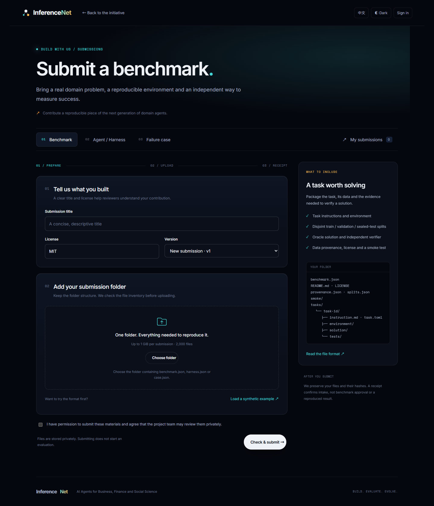
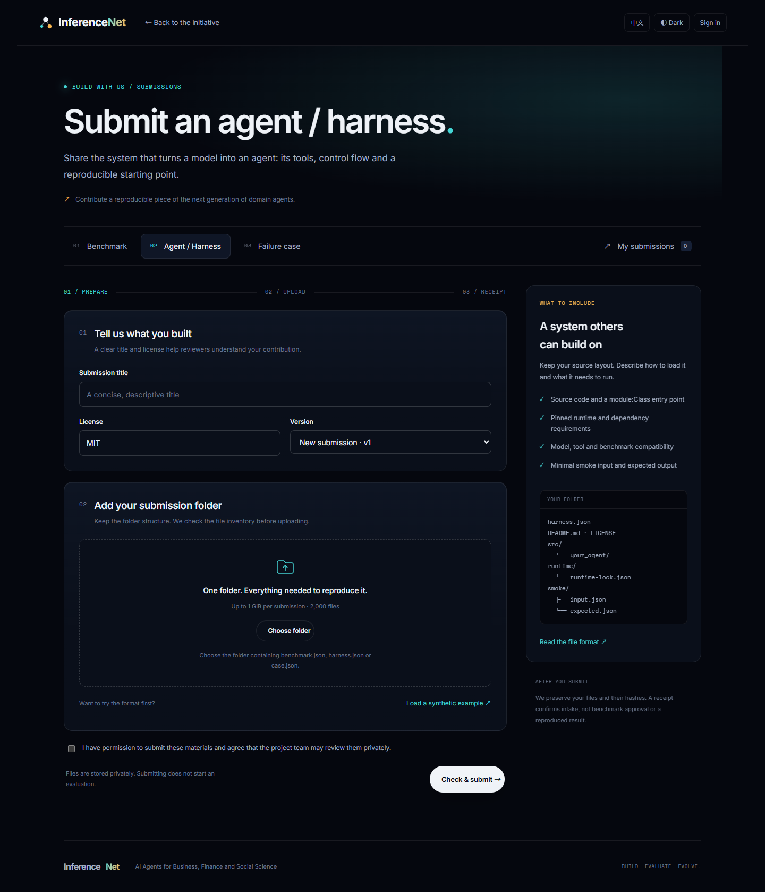
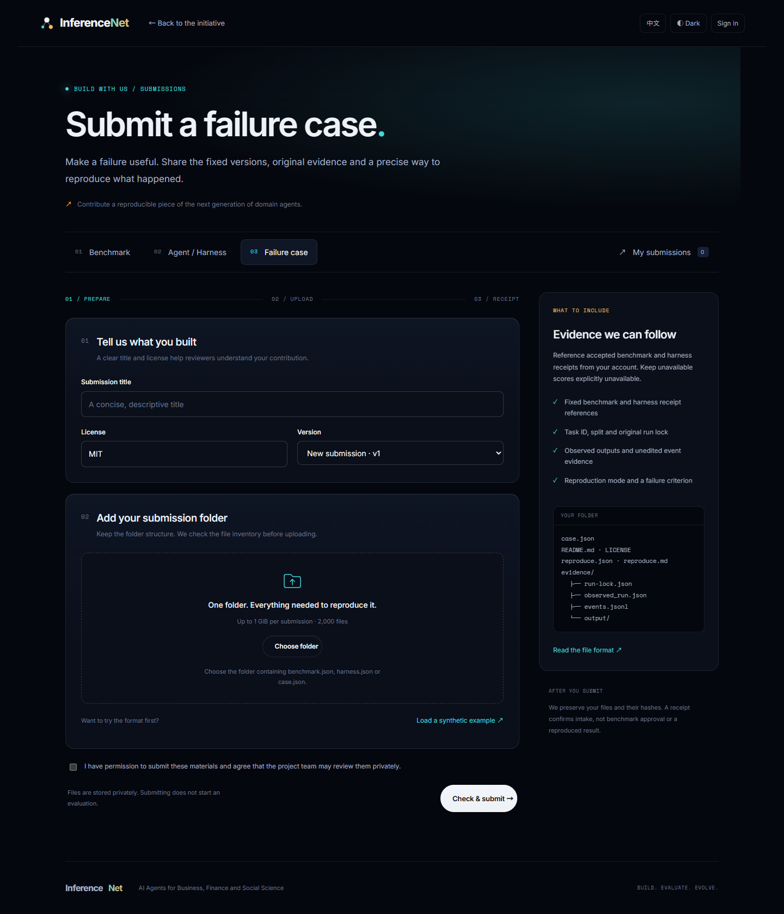
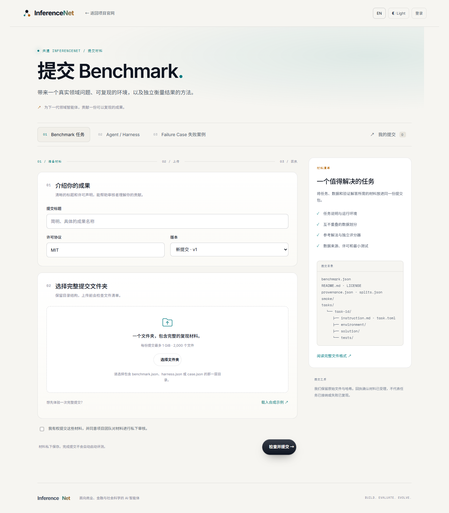

# Submission intake application — 2026-10-23

The three submission forms are deployed at `https://submit.inferencenet.cn` with
username/password accounts and private, versioned storage on the existing server.
This follows the infrastructure handoff in PR #38. The public-site CTA changes in
this PR become visible after this PR is merged and the public site is published;
the submission service itself is already available.

| Entry | URL |
|---|---|
| Benchmark | <https://submit.inferencenet.cn/submit/benchmark/> |
| Agent / Harness | <https://submit.inferencenet.cn/submit/harness/> |
| Failure Case | <https://submit.inferencenet.cn/submit/failure-case/> |
| My submissions | <https://submit.inferencenet.cn/submit/mine/> |

Register a username and a password of at least 12 characters, choose the folder
containing the type-specific JSON, review its title/license, and submit. The UI
preserves nested paths, shows hashing/upload progress and validation errors, and
provides a downloadable receipt after successful static checks. New versions
retain the previous version. A compatible existing `submission.json` supplies
metadata, while the server generates the final owner-bound manifest.

The forms reuse v2 typography, logo, colors, dark/light themes and English/Chinese
copy. The root and v2 home/challenge pages link their corresponding participation
cards to the service. API and operational details are in
[SELF-HOSTED.md](../submissions/SELF-HOSTED.md) and
[the service guide](../../submission_service/README.md).

## Storage and operating state

```text
/srv/inferencenet-submit/data/
  intake.sqlite3
  submissions/
    benchmark/<submission-id>/v<version>/
    harness/<submission-id>/v<version>/
    failure-case/<submission-id>/v<version>/
      submission.json
      <original folder contents>
  receipts/<submission-id>/v<version>.json
/srv/inferencenet-submit/staging/<upload-id>/
```

Data and staging are owned by the non-login service account with mode 700; app
releases are root-owned. Caddy handles HTTPS and proxies to Gunicorn on loopback.
The intake service and cleanup/backup timers are enabled. Accepted packages are
published with an atomic rename, and retries can finish interrupted publication.
The systemd writable parent mount keeps staging/data on the same mount; separate
bind mounts would prevent that rename even on the same underlying disk.

Initial deployed release: `intake-20261023-11e03aaf4e59` (before type-directory migration).
Initial source bundle SHA256:
`11e03aaf4e59f416efff07396fc5b2f5b6dfe2e1d9291efdab4c5ebd516827b9`.
The bundle contains the service source, shared v2 CSS and two font files.

An intake receipt means the files passed static format/integrity checks and are
awaiting review. Submitted programs are never run by this service. Synthetic
examples retain their not-run status and unavailable runtime/score values.
Failure cases use fixed receipts from the submitting account. Single-package
limits are 1 GiB and 2,000 files. Password recovery is an operator reset; email
recovery and an evaluation/approval queue are outside this implementation.

## Classified storage migration

The current release is `intake-20261023-ed90b71ed574`, with source bundle SHA256
`ed90b71ed5747e362ef41d562df341bcbd4f6919f56791f6a2b1f54c90a45d1c`.
All existing packages now use **type → submission ID → version**. The filesystem
type names are `benchmark`, `harness` and `failure-case`; API type names and
immutable artifact references are unchanged. Receipts retain their separate
`receipts/<id>/v<version>.json` location.

The installer stopped intake and cleanup, paused backup scheduling, preserved a
pre-migration backup, verified the entire migration plan, and moved the existing
directories without overwriting destinations. It then restarted intake and both
timers. The migration is repeatable and can finish after an interrupted move.
Restore a pre-classification backup only while intake is stopped, then run the
layout migration before starting a release that expects classified paths.

Six sealed versions were migrated, including one synthetic pre-migration QA
submission. All 68 payload files, manifest bytes, receipt hashes and account
records were preserved. Comparison against the pre-migration backup confirmed
byte-for-byte payload/manifest equivalence and identical submission metadata.
The original QA session still read its record and the identical receipt after
deployment. New submissions for all three types passed, including harness v2 and
Failure Case reads of the classified benchmark's task/split. The final check found
zero remaining flat directories to migrate and verified 9 classified versions /
104 payload files. The post-migration backup also verified all 9 accepted versions.

## Verification

Validation ran on 2026-10-22/23 using independent test accounts and synthetic data.

| Check | Result |
|---|---|
| `python -m pytest submission_service/tests -q` | 25 passed; ownership, CSRF/Origin, paths, hash failures/retries, versions, idempotency, crash recovery, no payload execution, complete/restarted migration and conflict/corruption preflight |
| `node scripts/check.mjs` | Passed public links, anchors, asset allowlist and private-path boundaries on Windows |
| JavaScript syntax and incremental SHA256 comparison | Passed; hash comparison against Node crypto across ten input/chunk boundary cases |
| Browser upload through production HTTPS | All three types accepted; receipts downloaded; no page exceptions |
| Local folder selection in the production form | Nested paths and a 16 MiB binary file preserved; manifest metadata imported |
| Login/logout and v2 upload | Passed; v1 retained and v2 received its own receipt |
| Service restart | Existing session, both version records and receipt download survived |
| Server-side stored bytes | All 17 benchmark, 10 harness and 9 failure-case payload files matched their manifests; receipt hashes matched manifest bytes |
| Backup verification | Archive SHA256 passed; restored SQLite integrity was `ok`; all nine accepted versions and their receipts were checked against the post-migration archive |
| Visual inspection | Three desktop forms and Chinese light theme inspected at 1440 px; no horizontal overflow |

The backup check restored the snapshot database in an isolated temporary directory
and read archived payloads directly; it did not overwrite the running database.
The 1 GiB limit is admission-tested; this acceptance run exercised a 16 MiB file,
not a full 1 GiB transfer. This is desktop browser verification, not a mobile
browser certification or a full server disaster-recovery drill.

## Screenshots

Anonymous production pages, without account names or uploaded materials:








